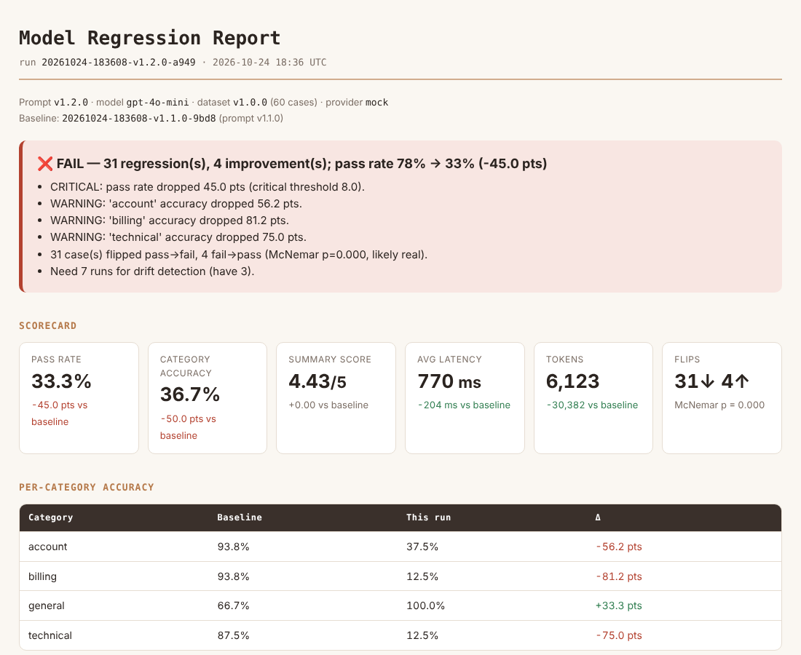

# Model Regression Detection System

  

This repo runs CI for prompts. Every pull request that touches `prompts/`, `config.yaml` or the golden dataset re-runs our customer-support email classifier against 60 human-labelled test cases, scores each case on four dimensions (category match, summary quality via LLM-as-judge, latency, tokens), and diffs the result against the committed baseline. The PR gets a comment listing every case that flipped from pass to fail, Slack gets an alert when something needs a human, and the merge is blocked if the pass rate drops more than 8 points. A nightly run on `main` tracks a 7-run moving average so that slow drift (for example, a silent model update by the provider) is caught even when no single run looks bad.



> New to the codebase? Read [`docs/PROJECT_GUIDE.md`](docs/PROJECT_GUIDE.md) first. It walks through every file in plain language.

---

## Setup

Requires Python 3.11+.

```bash
git clone <this repo> && cd model-regression-detector
python -m venv .venv && source .venv/bin/activate     # Windows: .venv\Scripts\activate
pip install -r requirements.txt
cp .env.example .env                                   # then fill in your keys
```

Sanity check, no API key needed:

```bash
python -m regdetect validate          # dataset + prompt files parse
python -m pytest -q                   # 11 offline tests
python -m regdetect run --provider mock
```

Real model:

```bash
export OPENAI_API_KEY=sk-...
python -m regdetect run                         # active prompt vs baseline
python -m regdetect run --prompt prompts/classifier_v1.2.0.yaml
python -m regdetect history
```

Open `reports/latest.html` for the full diff.

### Docker

```bash
docker build -t regdetect .
docker run --rm -e OPENAI_API_KEY -e SLACK_WEBHOOK_URL -e EVAL_PROVIDER=openai \
  -v "$PWD/reports:/app/reports" -v "$PWD/results:/app/results" regdetect run
```

The image defaults to `EVAL_PROVIDER=mock`. Every threshold in `config.yaml` can be overridden with an env var (`WARN_DELTA_PCT`, `CRITICAL_DELTA_PCT`, `DRIFT_WINDOW`, `DRIFT_MIN_PASS_RATE`, `ACTIVE_PROMPT`, ...; full list in `regdetect/config.py`).

### GitHub setup (one time)

1. **Secrets** (Settings → Secrets and variables → Actions): `OPENAI_API_KEY`, `SLACK_WEBHOOK_URL`. Both optional. Without the key, CI uses the mock provider; without the webhook, alerts are printed to the job log.
2. **Block merges**: Settings → Branches → add a rule for `main` → *Require status checks to pass* → select `eval`. Without this rule the check goes red but GitHub still lets you merge.
3. **Slack webhook**: api.slack.com/apps → Create app → Incoming Webhooks → Add to channel → copy the URL into the secret.

---

## Day-to-day workflow

**Changing a prompt**

1. Copy the current prompt to a new file with a bumped version, e.g. `prompts/classifier_v1.3.0.yaml`. Never edit a released version in place; old runs reference it.
2. Point `active_prompt` in `config.yaml` at the new file.
3. Run `python -m regdetect run` locally, open the report, fix what regressed.
4. Open a PR. CI posts the result as a comment and updates it on every push.
5. After merge, refresh the baseline: `python -m regdetect run --promote` (or `python -m regdetect promote`) and commit `baselines/baseline.<provider>.json`.

**Adding test cases to the golden dataset**

Cases live in `data/golden_dataset.json`. Each one needs:

| Field | Rule |
|---|---|
| `id` | Stable and unique, `<cat>-<nnn>` (e.g. `bil-017`). Never reuse or renumber; diffs join on it. |
| `input.text` | The email exactly as a customer would write it, typos included. |
| `expected.category` | The single correct label. |
| `expected.acceptable_categories` | Only for genuinely ambiguous emails. A second label that a reasonable human would also accept. |
| `expected.summary` | One sentence written by a person. Not generated. |
| `expected_difficulty` | `easy` / `medium` / `hard`. |
| `tags` | Free-form: `sarcasm`, `hinglish`, `very-short`, `keyword-trap`, ... |
| `notes` | Why this case exists. If you can't write this, the case probably isn't needed. |

Then bump `dataset_version`, add a `changelog` line, run `python -m regdetect validate`, and promote a new baseline in the same PR. The report flags runs whose dataset version differs from the baseline's, so reviewers know the bar moved.

The bar for a new case is a real failure or a realistic risk: a ticket that was misrouted in production, a new language we now support, a phrasing that tripped a previous prompt. Every case must be reviewed by a human before it lands; the point of the set is that it is ground truth.

**Adjusting thresholds**

All in `config.yaml`:

| Setting | Default | Meaning |
|---|---|---|
| `thresholds.warn_delta_pct` | 3.0 | Pass-rate drop (points) that raises a warning |
| `thresholds.critical_delta_pct` | 8.0 | Drop that fails CI and blocks merge |
| `thresholds.per_category_warn_pct` | 10.0 | Any single category dropping this much warns |
| `thresholds.significance_alpha` | 0.05 | McNemar p-value cut-off for "likely real" |
| `summary_pass_score` | 3 | Minimum judge score (1-5) for a case to pass |
| `drift.window` | 7 | Runs in the moving average |
| `drift.min_pass_rate` | 0.85 | Moving average floor |
| `drift.max_drop_pct` | 4.0 | Allowed fall vs the previous window |

With 60 cases one flipped case is ~1.7 points, so 3% ≈ 2 cases and 8% ≈ 5 cases. If you grow the dataset, these percentages automatically mean more cases.

---

## Architecture

```
                 prompts/*.yaml ──┐          data/golden_dataset.json
                                  ▼                       │
config.yaml ──► cli.py ──► runner.py ──► classifier.py ──► llm.py ──► OpenAI / Mock
                                  │            ▲
                                  │      scoring.py (LLM-as-judge)
                                  ▼
                    storage.py (SQLite history + baseline JSON)
                                  │
                compare.py (diff, thresholds, McNemar) ── drift.py (moving avg)
                                  │
              report.py (HTML + PR markdown) ── alerts.py (Slack)
                                  │
                         exit code 0 / 1  ──► GitHub Actions blocks merge
```

| Module | Responsibility |
|---|---|
| `schemas.py` | Every data contract (Pydantic). Prompt config, I/O, test case, results. |
| `config.py` | `config.yaml` + env-var overrides. Secrets are env-only. |
| `prompts.py` | Load YAML prompts, render `{categories}` / `{examples}`. |
| `llm.py` | Provider interface; `OpenAIProvider`, `MockProvider`. |
| `classifier.py` | The feature under test: `classify_email(text, prompt, provider)`. |
| `scoring.py` | Four-dimension scoring, judge prompt. |
| `runner.py` | Async batched execution, run summary. |
| `storage.py` | SQLite history, baseline JSON. |
| `compare.py` | Run-vs-baseline diff, status, significance. |
| `drift.py` | Moving-average slow-drift check. |
| `report.py` + `templates/` | Self-contained HTML report, PR comment. |
| `alerts.py` | Slack Block Kit message via incoming webhook. |
| `cli.py` | `run`, `promote`, `history`, `classify`, `validate`. |

### Decisions and why

- **Prompts are versioned files, not strings in code.** A prompt change is a code change and gets the same review. YAML keeps multi-line prompts readable in diffs. Versions are immutable so every historical run can be reproduced.
- **Baseline committed as JSON, history in SQLite.** CI runners start empty, so the comparison target must travel with the repo. Updating the baseline is a deliberate, reviewed commit. SQLite is only needed for trends; in CI it is carried between jobs with the Actions cache. Baselines are kept per provider (`baseline.mock.json`, `baseline.openai.json`) because comparing a mock run against a real model is meaningless.
- **A case passes only if category AND summary are good.** Category accuracy alone hides prompts that route correctly but write useless summaries. Latency and tokens are tracked and diffed but don't gate, since a cheaper prompt that is just as accurate should be allowed.
- **Diff by case, not just by score.** Two runs at 90% can fail completely different cases. Per-case flips are what a reviewer can act on.
- **Thresholds gate; McNemar informs.** With 60 cases a real 8-point drop (5 one-way flips) gives p ≈ 0.06, so gating on significance alone would let it through. We gate on the configured deltas and print the p-value so reviewers can tell "5 vs 0 flips" from "7 vs 2".
- **Drift check separate from the per-run check.** Five runs that each lose 1.5 points never trip a 3% warning but lose 7.5 points in total. The nightly scheduled run is what catches provider-side model changes, since nobody opens a PR when OpenAI updates a model.
- **Mock provider in the box.** It reads the category definitions out of the rendered prompt and keyword-matches, so a vaguer prompt really scores worse. Contributors without API keys and forks without secrets get the full pipeline. It is a stand-in for wiring, not for model quality; real decisions use `provider: openai`.
- **`response_format=json_object` + Pydantic validation.** The model is forced to return JSON, and the output is then validated against the contract. A contract violation counts as a failed case, not a crash.
- **Temperature 0, judge at temperature 0.** Reduces run-to-run noise so flips mean something.
- **Slack failures never fail the eval.** Alerting is best-effort; the PR check is the source of truth.

### Known limits

- LLM-as-judge shares biases with the model being judged. Spot-check judge scores against your own when you change the judge model.
- At 60 cases the system detects large drops reliably and small ones only via drift. Grow the dataset toward 100+ for finer resolution.
- The mock judge is word overlap. Very short emails (`hi`, `refund pls`) score low on summaries under mock; that is expected.

---

## Repository layout

```
├── regdetect/            # the package (see table above)
├── prompts/              # versioned prompt YAML (v1.0.0, v1.1.0 = active, v1.2.0 = demo regression)
├── data/                 # golden dataset
├── baselines/            # accepted baseline run per provider
├── reports/sample/       # example report + PR comment from the v1.2.0 regression
├── tests/                # offline pytest suite
├── docs/PROJECT_GUIDE.md # beginner walkthrough of the code
├── .github/workflows/    # eval.yml (PR + nightly), tests.yml
├── Dockerfile
└── config.yaml
```
